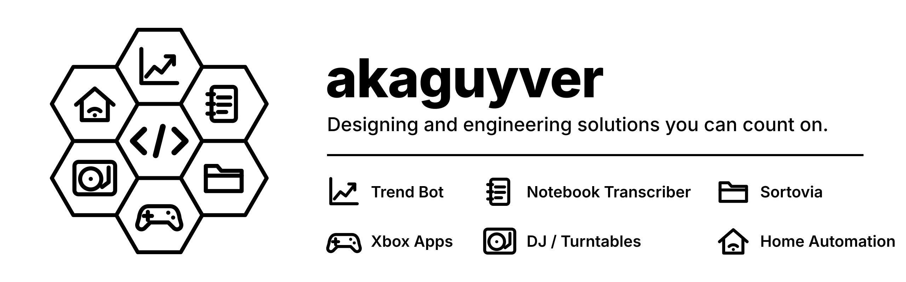

  <picture>
    <source media="(prefers-color-scheme: dark)" srcset="assets/banner-black.png">
    <source media="(prefers-color-scheme: light)" srcset="assets/banner-white.png">
    
  </picture>

## About me

Designing and engineering solutions you can count on. I bring a builder's mindset from years of carpentry, trim and cabinets, low voltage and home automation to software: plan it right, build it solid and make it work every time.

I build practical software that solves real problems, and I test it on the hardware it has to run on.

## Featured project: Sortovia

**[Sortovia](https://github.com/sortovia/sortovia)** is a free add-on for Kodi that turns a pile of downloads into a tidy library that Kodi can read. It shows the full plan first, and nothing moves until you approve it.

I built it to manage a large media library on an Xbox, using only an Android phone, with no PC available.

- About 21,000 lines of Python, with over 500 automated tests that run against a simulated Kodi
- An Android companion app in Java (about 18,000 lines), with a DJ deck screen and its own audio engine, plus phone tools that share files over Wi-Fi
- Automatic updates verified by checksum, and sorts that can resume if Kodi closes
- Optional passcode encryption for saved passwords, and a problem-report tool that removes private details from logs before anyone sees them

The [engineering notes](https://github.com/sortovia/sortovia/blob/main/DEVELOPMENT.md) explain the design, including the Xbox behaviour I had to find by reading real device logs. For example, renames always fail on its removable drives, and a missing file reports a size of 0 instead of an error.

I built Sortovia with [Claude Code](https://claude.com/claude-code), an AI coding tool, as a development partner. I set the direction, tested it on real hardware, and drove the fixes from what I found.

## Other projects

| | Project | What it does |
|---|---|---|
| 📈 | **Trend Bot** | Python crypto bot that goes long on uptrends and short on downtrends, using TradingView-style indicators converted from Pine Script. |
| 📓 | **Notebook Transcriber** | Turns handwritten notebook pages into text. Built with Claude Code running in Termux on Android. |
| 🎮 | **Xbox Apps** | More native Xbox apps planned. |
| 🎧 | **DJ / Turntables** | The Sortovia Android app (APK) includes a full-featured turntable with automix that uses real DJ-style transitions. It also has genre lookup from multiple sources, a full tag editor, phrase analysis, beatgrid editing, key detection and export to a Rekordbox XML file. |
| 🏠 | **Home Automation** | Smart-home and low-voltage systems from my construction work. |

## Skills

Python · Java · Android · Bash · Git and GitHub Actions · Kodi add-ons · WebDAV · automated testing
